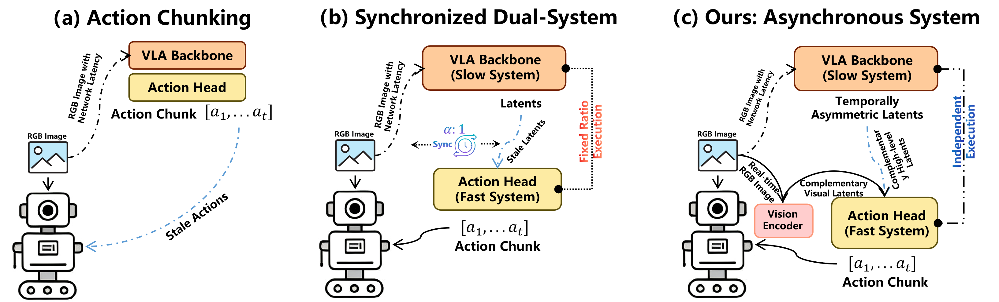
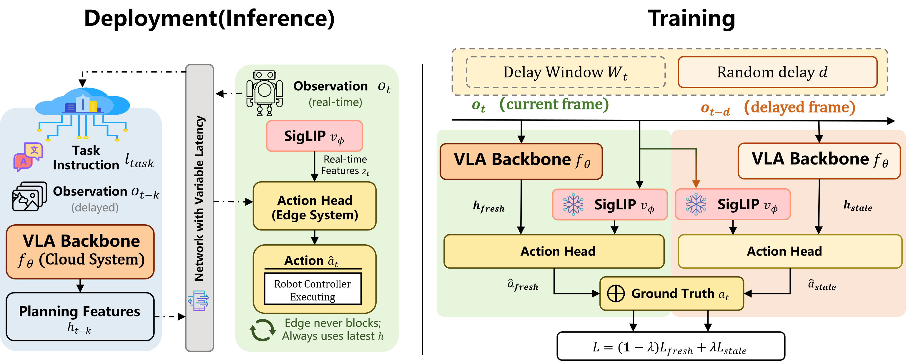
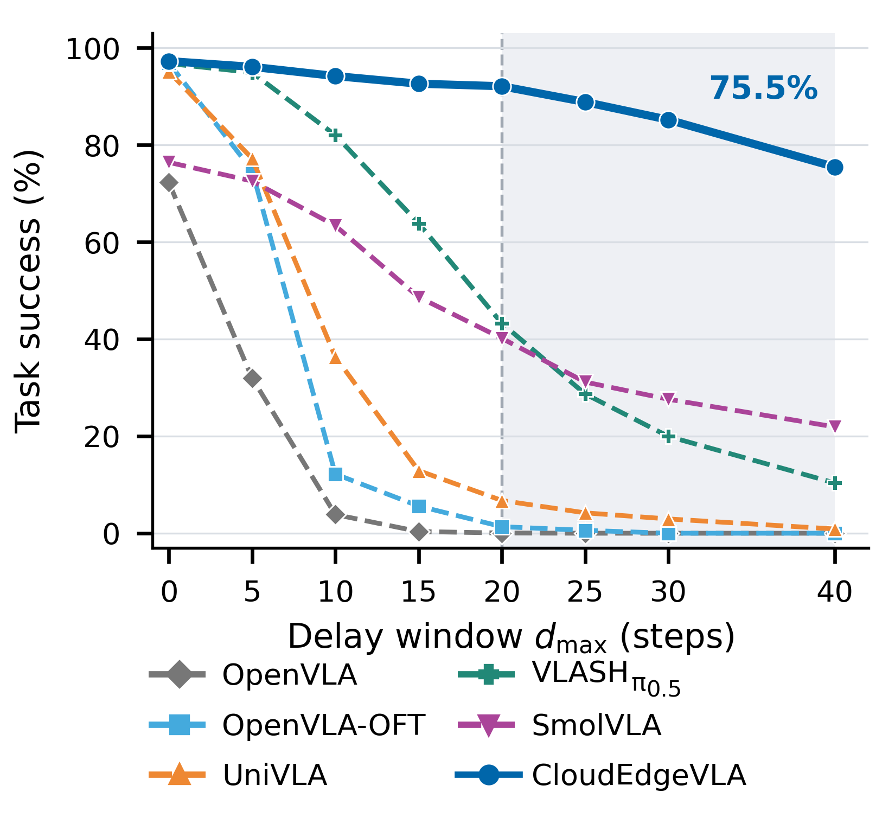

# CloudEdgeVLA

Official implementation of **Latency-Tolerant Cloud-Edge Collaborative
Vision-Language-Action Models via Emergent Representational Specialization**.

[[Paper](https://arxiv.org/abs/2608.00569)]
[[Project Page](https://daojiepeng.github.io/CloudEdgeVLA/)]
[[Model](https://huggingface.co/DaojiePENG/cloudedgevla-libero-spatial-object-goal-10)]

Cloud-edge deployment is how a 7B Vision-Language-Action (VLA) model reaches a
robot: the large backbone stays in the data center and the robot runs a small
action head. The difficulty is temporal. Control runs at tens of hertz, while a
cloud round trip spans many control steps, so the feature the robot acts on was
computed from an observation that is already out of date. Re-planning an action
chunk in the cloud pushes the next usable update further out. Synchronized
fast-slow pipelines instead pin a fixed cloud-to-edge frequency ratio and a
latency bound that a wireless link rarely honours.

CloudEdgeVLA drops both assumptions. The cloud keeps producing planning
features, and the edge fuses the most recently received feature with vision of
the current frame and executes an action chunk without ever waiting on the
cloud. Paired-frame dual-path training is what makes a stale feature worth
using: the same decision is supervised twice, once from the current frame and
once from a randomly delayed frame, which presses the cloud representation
toward task-level content that changes slowly and routes state-sensitive
correction to the edge path.

<p align="center">
  <br>
  <sub><b>Conceptual comparison of dual-system paradigms</b> (paper Figure 1).
  <b>(a)</b> Action-chunk re-planning assumes the environment is static during
  open-loop execution, so staleness compounds. <b>(b)</b> Synchronized
  fast-slow pipelines require a fixed frequency ratio <code>alpha</code> and
  bounded latency, conditions rarely met in networked deployments.
  <b>(c)</b> CloudEdgeVLA: the cloud produces delay-resilient planning features
  and the edge grounds them with real-time vision, with no temporal alignment
  and no blocking wait.</sub>
</p>

On the four LIBERO suites CloudEdgeVLA retains **66.7--79.7%** success with a
40-step uniform-delay window, against at most 35.8% for the evaluated
baselines. The four-suite average is **75.5%**, versus 21.9% for SmolVLA and
10.4% for VLASH with a pi-0.5 backbone. Delay is sampled up to 20 steps during
training only; 40 steps is extrapolation.

| To | Read |
|---|---|
| understand how the method works | [Method](#method) |
| load the released checkpoint | [Released checkpoint](#released-checkpoint), [Quick start](#quick-start) |
| retrain on LIBERO data | [Data](#data), [Training](#training) |
| reproduce the paper's numbers | [Evaluation](#evaluation), [Results](#results) |

## Overview

At control step `t` the robot holds a cloud feature computed from `o_(t-d)`,
where `d` is however many steps the cloud took to answer, and `d` is neither
known nor bounded. CloudEdgeVLA treats that as a representation-learning
problem rather than a clock-synchronization problem.

```text
Cloud:  delayed observation o_(t-d) + instruction
                         |
                  7B VLA backbone  f_theta
                         |
              latest received feature h_(t-d)
                         |
                         v
Edge:   current observation o_t -> frozen SigLIP v_psi -> z_t
                         |                                  |
                         +------ Vision-Augmented ----------+
                                  Action Head  g_phi
                                        |
                                 action chunk a_t
```

The edge always executes with the most recently received cloud feature. It does
not wait for a particular response and does not need to know how many steps old
that feature is.

## Method

<p align="center">
  <br>
  <sub>Cloud-side VLA backbone, edge-side vision encoder, and edge-side action
  head. Only the cloud path is exposed to observation delay.</sub>
</p>

### Cloud- and edge-side components

The cloud backbone `f_theta` is a 7B OpenVLA model adapted with LoRA. It maps a
(possibly stale) observation and the language instruction to the final-layer
hidden states at the action-token positions, `h in R^(L x D)`, where
`L = T x A` covers an action chunk of length `T` with `A` action dimensions.
It is trained to encode *what* to do rather than *exactly when* to do it.

The edge runs two small modules. A frozen SigLIP-Base encoder `v_psi` extracts
features `z_t = v_psi(o_t)` from the current observation, and the
Vision-Augmented Action Head `g_phi` concatenates the cloud features with the
projected current visual features and predicts the action chunk through a
residual MLP:

```text
a_hat_t = g_phi(h_(t-d), z_t)
```

`z_t` is always computed from the current frame, so the head acts as a
real-time grounding layer for possibly stale cloud directives.

### Paired-frame dual-path training

Each training sample provides a window of `W` consecutive observations from the
same episode. The current frame `o_t` and a randomly delayed frame `o_(t-d)`,
with `d ~ Uniform{1, ..., W-1}`, are both passed through the cloud backbone. The
stale branch is not detached, so both passes receive gradients. Both sets of
planning features are fused with the *same* current vision features `z_t` and
supervised toward the *same* ground-truth action:

```text
L = (1 - lambda) * ||a_hat_fresh - a_t||_1 + lambda * ||a_hat_stale - a_t||_1
```

`lambda` ramps linearly from 0 to `lambda_max = 0.5` over the first 40% of
training, so the backbone first learns strong representations and is only then
pressed toward delay invariance.

Because the stale path sees an action target from time `t` and a cloud input
from time `t-d`, features tied purely to the instantaneous state of `o_(t-d)`
are unreliable predictors of `a_t`, while task identity, goal, and coarse
progress stay predictive. This drives the cloud representation toward slow,
task-level content and routes state-sensitive corrections to the edge vision
path. We refer to this as emergent representational specialization.

### Deployment protocol

1. The robot captures `o_t` and sends it to the cloud asynchronously.
2. When the cloud returns `h`, the edge replaces its stored cloud feature.
3. The edge computes `z_t = v_psi(o_t)` locally.
4. The edge computes `a_hat_t = g_phi(h_received, z_t)` and executes it.

No step waits for the cloud, and measured latency is never an input to the
policy.

## Released checkpoint

[`DaojiePENG/cloudedgevla-libero-spatial-object-goal-10`](https://huggingface.co/DaojiePENG/cloudedgevla-libero-spatial-object-goal-10)
is the 95,000-step checkpoint of a 100,000-step run on the merged four-suite
mixture (23.4 epochs, effective batch 64, 21-frame window). It is the checkpoint
behind every CloudEdgeVLA number reported below.

| File | Needed for |
|---|---|
| `model-0000{1..4}-of-00004.safetensors`, `model.safetensors.index.json` | merged 7B backbone |
| `action_head--95000_checkpoint.pt` | edge action head |
| `proprio_projector--95000_checkpoint.pt` | proprioception projector |
| `config.json`, `*_prismatic.py`, `dataset_statistics.json`, tokenizer files | model config, remote code, action normalization |
| `training_state.pt`, `lora_adapter/` | optional: resuming training only |

Inference loads the checkpoint straight from the Hub through the repository id,
so nothing needs to be downloaded or rearranged by hand.

## Quick start

```bash
git clone https://github.com/DaojiePENG/CloudEdgeVLA.git
cd CloudEdgeVLA
conda create -n cloudedgevla python=3.10 -y
conda activate cloudedgevla
python -m pip install --upgrade pip setuptools wheel
python -m pip install -e .
```

Follow [SETUP.md](SETUP.md) for the full environment (FlashAttention, LIBERO,
datasets) and [LIBERO.md](LIBERO.md) for the simulator. LIBERO reads its asset
paths from `LIBERO_CONFIG_PATH` (default `~/.libero/config.yaml`); point it at
your own LIBERO checkout before evaluating.

Verify that the released weights load:

```bash
python scripts/check_hub_checkpoint.py
```

Evaluate the Hub checkpoint on LIBERO-Goal with a 40-step delay window:

```bash
bash scripts/eval_libero_delay_sweep.sh \
  --checkpoint DaojiePENG/cloudedgevla-libero-spatial-object-goal-10 \
  --suites libero_goal --delays 40 --num-trials 10 --seed 7 --gpu 0
```

## Results

Task success (%) on LIBERO under uniformly sampled observation delay
`k ~ Uniform{1, ..., d_max}`. CloudEdgeVLA entries are mean ± sample standard
deviation over evaluation seeds 7, 8, and 9. Published baselines are point
estimates from their papers; SmolVLA, SmolVLA+A2C2, and VLASH with a pi-0.5
backbone were re-evaluated under the same delay protocol with their released
checkpoints. Dashes: no official A2C2 checkpoint for Goal and Long.

| Method | d_max=0 | | | | d_max=10 | | | | d_max=20 | | | | d_max=40 | | | |
|---|---|---:|---:|---:|---:|---:|---:|---:|---:|---:|---:|---:|---:|---:|---:|---:|
| | Spat. | Obj. | Goal | Long | Spat. | Obj. | Goal | Long | Spat. | Obj. | Goal | Long | Spat. | Obj. | Goal | Long |
| OpenVLA | 84.6 | 71.2 | 77.0 | 56.2 | 6.8 | 1.2 | 2.2 | 5.2 | 0.2 | 0.0 | 0.0 | 0.0 | 0.0 | 0.0 | 0.0 | 0.0 |
| OpenVLA-OFT | 98.4 | 98.6 | 97.2 | 93.4 | 10.6 | 3.6 | 26.2 | 8.4 | 0.0 | 0.0 | 4.0 | 1.4 | 0.0 | 0.0 | 0.0 | 0.0 |
| UniVLA | 96.0 | 96.6 | 94.6 | 93.2 | 27.4 | 34.8 | 48.2 | 35.0 | 0.4 | 2.6 | 21.8 | 2.2 | 0.0 | 0.0 | 3.0 | 0.5 |
| SmolVLA | 82.6 | 90.0 | 82.6 | 50.4 | 64.6 | 76.0 | 68.4 | 44.4 | 46.2 | 35.6 | 45.6 | 33.2 | 28.8 | 5.4 | 35.8 | 17.6 |
| VLASH (pi-0.5) | 97.8 | 98.8 | 95.8 | 94.6 | 75.8 | 85.6 | 81.8 | 84.8 | 34.0 | 35.2 | 60.4 | 43.4 | 3.6 | 1.2 | 31.4 | 5.2 |
| SmolVLA + A2C2 | 77.0 | 84.2 | -- | -- | 62.0 | 65.4 | -- | -- | 33.8 | 40.0 | -- | -- | 32.0 | 5.0 | -- | -- |
| **CloudEdgeVLA** | **97.0** ±0.0 | **100.0** ±0.0 | **96.0** ±0.0 | **96.0** ±0.0 | **94.7** ±3.2 | **97.7** ±1.5 | **95.3** ±2.5 | **89.0** ±1.0 | **93.0** ±1.7 | **95.3** ±2.5 | **93.7** ±2.9 | **86.3** ±5.9 | **79.7** ±3.5 | **77.7** ±5.0 | **77.7** ±4.5 | **66.7** ±3.2 |

**Evaluation protocol.** CloudEdgeVLA is one checkpoint trained on the merged
four-suite mixture and evaluated with three seeds (7, 8, 9), 10 rollouts per
task per seed, taken from the first ten of LIBERO's fifty initial states. At
`d_max = 0` no delay is sampled, so the seeds share an identical execution path
and the standard deviation is zero by construction. Delay draws are seeded per
(evaluation seed, task, episode), so a sweep is reproducible from `--seed` alone.

**Four-suite averages.** At `d_max = 40` CloudEdgeVLA averages 75.5%, against
21.9% for SmolVLA and 10.4% for VLASH. Relative to its own synchronous score it
retains 77.6% of success versus 28.7% for SmolVLA, and it reaches a normalized
delay area-under-curve of 92.0% versus 58.5% over the full
`d_max in {0, 5, 10, 15, 20, 25, 30, 40}` grid.

**Against current-observation correction.** A2C2 corrects stale action chunks
with fresh local observations, which is the closest comparison to the edge path
here. At `d_max = 40` CloudEdgeVLA reaches 79.7% / 77.7% on Spatial / Object
versus 32.0% / 5.0% for SmolVLA+A2C2. On LIBERO-Long it exceeds the strongest
evaluated baseline by 49.1 points (66.7% versus 17.6% for SmolVLA), compared
with a 4.2-point margin at `d_max = 10`; the advantage grows with staleness,
which is where multi-stage manipulation breaks first.

<p align="center">
  <br>
  <sub>Four-suite success over the full delay grid, shading delays beyond the
  20-step training window. The table above reports the four evaluated delay
  windows from the same runs.</sub>
</p>

## Data

Fine-tuning uses the modified RLDS conversions of LIBERO hosted on Hugging Face:

```bash
git lfs install
git clone https://huggingface.co/datasets/openvla/modified_libero_rlds \
  /path/to/modified_libero_rlds
```

The training mixture `libero_4_task_suites_no_noops` is already registered in
`prismatic/vla/datasets/rlds/oxe/mixtures.py` and combines
`libero_spatial_no_noops`, `libero_object_no_noops`, `libero_goal_no_noops`, and
`libero_10_no_noops` (1,693 trajectories / 273,465 transitions). Pass
`--suite spatial|object|goal|10` to the launcher to train a single suite instead.

## Training

```bash
VLA_PATH=/path/to/openvla-7b-oft-finetuned-libero-spatial-object-goal-10 \
DATA_ROOT_DIR=/path/to/modified_libero_rlds \
RUN_ROOT_DIR=/path/to/runs \
NUM_GPUS=8 bash scripts/train_libero_all.sh
```

Add `--resume` to continue from the latest checkpoint of the same run. Set
`WANDB_ENTITY` to log online; otherwise W&B runs offline.

| Setting | Value |
|---|---|
| Base checkpoint | merged OpenVLA-OFT LIBERO checkpoint |
| LoRA rank | 16 |
| Action chunk length | 8 (parallel decoding) |
| Edge encoder | frozen SigLIP-Base, 2 views |
| Frame window `W` | 21 (training delays 1--20) |
| Stale-loss maximum `lambda_max` | 0.5, linear ramp over 40% of steps |
| Learning rate | 5e-4, decayed 10x at 64% of training |
| Batch | 8 per GPU x 8 GPUs = 64 effective |
| Optimization | 100,000 steps (~23.4 epochs) |
| Precision | bf16 |

Paired-frame training performs two backbone forward passes per step, so its
memory and wall-clock cost are roughly double the single-path OpenVLA-OFT
recipe. On an 80 GB GPU set `BATCH_SIZE=4` (effective batch 32) or use gradient
accumulation. Checkpoints are saved every 5,000 steps; LoRA weights are merged
during training so that each checkpoint can be evaluated directly.

## Evaluation

`scripts/eval_libero_delay_sweep.sh` runs any (suite, delay) matrix for a local
checkpoint directory or a Hub repo id, with the model settings of the released
checkpoint baked in. Finished cells are skipped on restart, and one row per
cell is appended to `<out-dir>/summary.csv`.

```bash
# Paper matrix: 4 suites x 4 delay windows x 3 seeds
for SEED in 7 8 9; do
  bash scripts/eval_libero_delay_sweep.sh \
    --checkpoint DaojiePENG/cloudedgevla-libero-spatial-object-goal-10 \
    --seed "$SEED" --gpu 0 --out-dir eval_logs/seed"$SEED"
done
```

Set `MUJOCO_GL=osmesa` on machines without an EGL-capable GPU stack. If EGL
enumeration does not follow the CUDA device order (software mesa rendering
exposes a single EGL device, for example), set `EGL_DEVICE_ID` to the index that
works. Rollout videos are disabled by default because they dominate disk usage;
enable them with `--save-rollouts true`.

To evaluate a local checkpoint, pass the directory instead of the repo id. It
must contain merged weights, `dataset_statistics.json`, one
`action_head--*_checkpoint.pt`, and one `proprio_projector--*_checkpoint.pt`.

Delays are counted in environment steps, not network milliseconds; converting
between the two requires the deployment control rate.

## Representation analysis

The paper's mechanism analysis can be re-run with:

| Script | Purpose |
|---|---|
| `scripts/visualize_backbone_head_delay_mechanism.py` | Backbone representation drift and how much of it the head transfers to actions |
| `scripts/visualize_fresh_stale_action_consistency.py` | Fresh versus stale action agreement per timestep |
| `scripts/visualize_representational_probe.py` | Task-level and motor-state information in backbone features |
| `scripts/visualize_action_head_attribution.py` | Reliance of the action head on cloud versus edge inputs |
| `scripts/visualize_closed_loop_delay_robustness.py` | Per-suite closed-loop delay curves |
| `scripts/plot_closed_loop_delay_robustness.py` | Four-suite average curve, retention, and delay AUC |

See [scripts/README_probe.md](scripts/README_probe.md) and
[scripts/README_attribution.md](scripts/README_attribution.md) for the full
workflows.

## Repository layout

| Path | Purpose |
|---|---|
| `prismatic/models/action_heads.py` | Vision-Augmented Action Head and its frozen vision encoder |
| `prismatic/vla/datasets/datasets.py` | Same-episode window extraction and delayed-frame sampling |
| `vla-scripts/finetune.py` | Paired-frame dual-path training loop and loss |
| `experiments/robot/frame_delay.py` | Delay buffer and uniform delayed-frame sampling at eval time |
| `experiments/robot/libero/run_libero_eval.py` | LIBERO evaluation with simulated cloud delay |
| `experiments/robot/openvla_utils.py` | Model loading, including Hub checkpoints and their components |
| `scripts/train_libero_all.sh` | Training entry point |
| `scripts/eval_libero_delay_sweep.sh` | Evaluation entry point |
| `scripts/check_hub_checkpoint.py` | Hub loading smoke test |
| `tests/test_frame_delay_alignment.py` | Frame/action temporal-alignment tests |

## Acknowledgements

CloudEdgeVLA is built on
[OpenVLA-OFT](https://github.com/moojink/openvla-oft), which builds on
[OpenVLA](https://openvla.github.io/). Evaluation uses the
[LIBERO benchmark](https://github.com/Lifelong-Robot-Learning/LIBERO), the edge
encoder is [SigLIP](https://github.com/google-research/big_vision), and the
baselines are [UniVLA](https://github.com/OpenDriveLab/UniVLA),
[SmolVLA](https://github.com/huggingface/lerobot),
[A2C2](https://github.com/SendAI/A2C2), and
[VLASH](https://github.com/OpenHelix-Team/VLASH). We thank the authors for
releasing their code, models, and data.

This repository is released under the [MIT License](LICENSE). Pretrained models
and datasets may be subject to their own licenses and terms.

## Citation

If this work is useful in your research, please cite:

```bibtex
@misc{peng2026latencytolerantcloudedgecollaborativevisionlanguageaction,
  title         = {Latency-Tolerant Cloud-Edge Collaborative
                   Vision-Language-Action Models via Emergent
                   Representational Specialization},
  author        = {Daojie Peng and Fulong Ma and Bingtao Wang
                   and Sheng Wang and Jun Ma},
  year          = {2026},
  eprint        = {2608.00569},
  archivePrefix = {arXiv},
  primaryClass  = {cs.RO},
  url           = {https://arxiv.org/abs/2608.00569}
}
```
